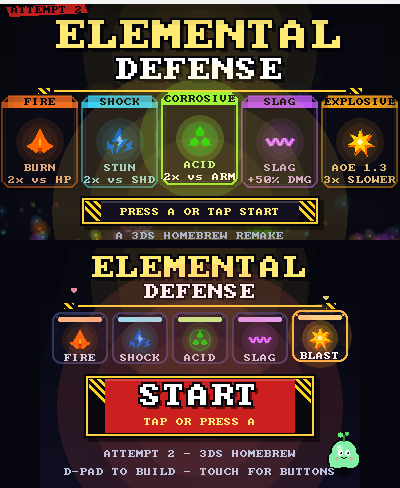
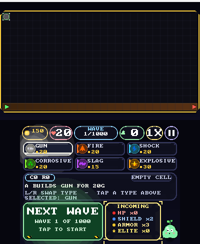
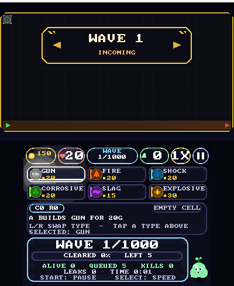
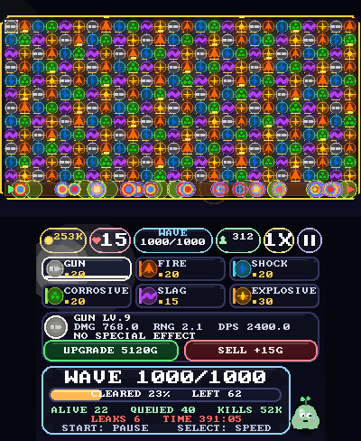
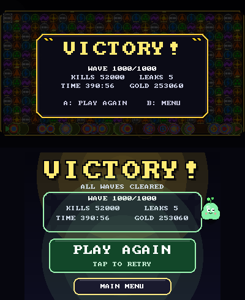
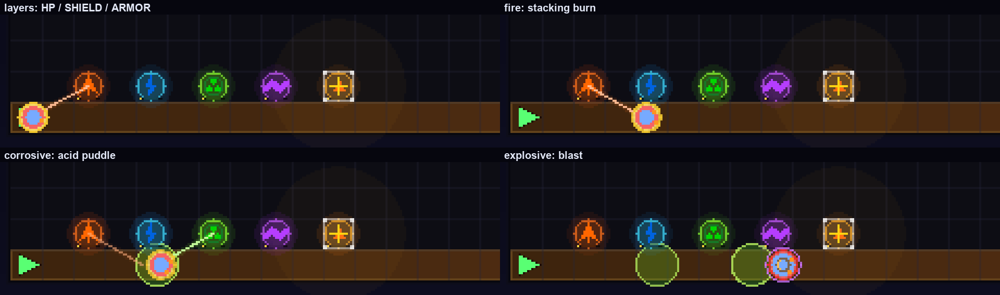

# Attempt 2: Elemental Defense for the 3DS

A tower defense game I originally wrote in LÖVE2D, rebuilt from scratch in C so it actually runs
properly on a Nintendo 3DS — with a Borderlands-style layered damage model, a BL2-inspired title
screen full of element weapon cards, streaming music with sound effects, and now a **1000-round
campaign with no tower limit** and a single-screen, cuter touch UI (with a mascot).

The first attempt ran the LÖVE version through LovePotion. It booted! And then crawled at a few
frames per second with half the playfield off-screen and touch controls fighting LÖVE's mouse
emulation. Rather than keep patching a compatibility layer that was never going to behave, this repo
is the native rewrite: same core idea, drawn with `citro2d`.

The old attempt for posterity: [tower-defense-3ds-psvita-project-attempt](https://github.com/Mist-Eros/tower-defense-3ds-psvita-project-attempt)



## What the game is

A grid tower defense on a 26x13 board. Creeps crawl along a road from the left edge to the right, you
build towers to stop them, and every kill pays for the next tower.

Two things make it different from a normal tower defense:

**You build on the road, not just next to it.** Every tower you drop on the path makes the creeps
recalculate their route around it, so the game is about walling off the short way and forcing them
through a long winding detour that keeps them in range of more towers. The route is a BFS shortest
path and gets recomputed after every build and every sell; creeps already on the road follow the new
route. Block the road completely and the game won't let you place the tower.

**Enemies are stacks of 1–3 concentric rings.** Every ring is red **HP**, blue **Shield** or yellow
**Armor**, destroyed from the outside in. You have six damage types — normal, fire, electric,
corrosive, slag and explosive — and each elemental one is strong against one ring type, weak against
the others, and does something else on top:

| Tower | Damage type | Cost | Strong vs | What it does |
|---|---|---|---|---|
| **GUN** | normal | 20 | everything equally | straight single-target damage |
| **FIRE** | fire | 20 | HP ×2 | stacks a burn (up to 5 stacks, 2.5 s) |
| **SHOCK** | electric | 20 | Shield ×2 | stuns for 0.3 s |
| **CORROSIVE** | corrosive | 20 | Armor ×2 | drops a 5 s acid puddle that burns everything walking over it |
| **SLAG** | slag | 15 | — | target takes +50% damage from everything and moves slower; slag itself hits weakly |
| **EXPLOSIVE** | explosive | 30 | everything equally | area blast (1.3 cells) but fires 3× slower |

Strong multipliers are ×2, weak multipliers ×0.5; normal and explosive are ×1 against every layer.
Waves 1–3 have single-ring creeps, waves 4–8 have two rings, waves 9+ have all three; elites get an
extra ring. Towers upgrade ten levels (damage doubles each level), you have 20 lives, elites show up
every 5th wave, and at high waves they come as dense bursts (up to 80 spawns, 10 elites, capped speed).

**There is no tower limit.** Build as many towers as the board and your gold allow — every cell that
isn't occupied by another tower, the entrance or the exit is fair game, and the maze re-routes creeps
around whatever you place. **The campaign is 1000 rounds**; clear all of them for the win. It's a
marathon: roughly 5½ hours at 1× speed (about 1½ hours with the 4× speed toggle), with late waves
leaking through unless your maze and upgrades are on point.

Top screen is **only the battlefield** — no HUD band, no duplicated numbers. Everything persistent
lives on the bottom touch screen: stat chips (gold, lives, wave x/1000, towers, speed, pause), the
six-tower palette, upgrade/sell, the wave panel, and a reactive little mascot slime that celebrates
builds and worries about leaks. A one-shot **WAVE N INCOMING** banner slides across the battlefield
when you call a wave. The game is paused between waves so you can build as long as you like.

## Screenshots

Rendered by the game's own frame code (top screen above, touchscreen below) — the PC preview
harness runs the same `game.h`/`gfx.h` rendering the 3DS backend uses, so this is exactly what the
console draws:

| Menu: element weapon cards | Build phase: battlefield only on top, full UI below | Wave incoming |
|---|---|---|
|  |  |  |

Late game (round 1000/1000, 336 towers) and the win screen:

| Late-game HUD at 1250 gold / 336 towers | Victory, clamped at 1000/1000 |
|---|---|
|  |  |

Close-ups of the damage model (layered rings, burn stacks, acid puddle, explosive blast):



## Playing it

Grab `ElementalDefense.3dsx` from the [releases page](https://github.com/Mist-Eros/Attempt-2-3ds-game/releases), drop it in `/3ds/` on your SD
card, launch it from the Homebrew Launcher. Needs a 3DS with homebrew (Luma3DS/CFW or any entry
point that can run `.3dsx` files).

### Controls

| Input | Action |
|---|---|
| Touchscreen | all the buttons on the bottom screen (tower type, upgrade, sell, next wave, pause) |
| D-pad | move the build cursor on the battlefield |
| A | place the selected tower |
| X / Y | upgrade / sell the selected tower |
| L / R | cycle the six damage types |
| Start | pause |
| Select | change game speed (1x / 2x / 4x) |
| Touchscreen chips | pause, speed, tower selection, upgrade/sell, next wave |

Tapping a placed tower with your finger on the bottom screen isn't a thing yet (the battlefield is on
the top screen, which isn't touch) — the D-pad cursor is how you select one, or the panel shows the
tower you placed most recently.

Playing under an emulator (I use Azahar)? I map **WASD** to the d-pad, **U/H/J/K** to X/Y/B/A and
**Q/I** to L/R there; Start/Select are M/N.

### Sound

The 3DS build has audio. The music is the **actual full soundtrack**, not a short loop: the two OGG
tracks (a 2:08 menu theme and a 4:07 game theme) are linked into the `.3dsx` and streamed through the
[libctru `ndsp`](https://libctru.devkitpro.org/) mixer with **Tremor** (the fixed-point Vorbis decoder),
decoded a quarter-second at a time from the main loop. If the OGG decoder can't start it falls back to
short embedded PCM loops, so music never drops out entirely.

Sound effects cover building, selling, upgrading, lasers, enemies dying, wave starts, leaks, game over
and victory. They come from the original LÖVE project's assets (the two little sting sounds were
generated); `tools/make_audio.py` builds the linked audio blobs.

One caveat: the 3DS audio service needs the **DSP1 firmware** loaded. On Luma3DS that usually means
having DSP1 installed/enabled; if it's missing, the game detects `ndspInit()` failing and just runs
silently instead of crashing. (The Azahar/Citra emulator doesn't provide DSP firmware by default, so
sound is a real-hardware thing.)

## Status

Playable end to end: maze building on the road, **1000 rounds**, **no tower cap** (up to 336 towers on
the board, occupancy indexed for the whole board), six damage types against layered enemies, status
effects, upgrades, lives, game over, victory, streaming music + sfx, and a custom Homebrew Launcher
icon. v0.7 removed the duplicated top HUD (top screen is a pure battlefield in a chunky comic frame),
redesigned the bottom screen as rounded pastel stat chips + palette + selected panel + INCOMING panel,
and added the mascot slime plus the one-shot wave banner. The late-game HUD is verified to fit
1000/1000 waves, 4-digit gold and 336 towers. It boots at a stable 60 fps in the Azahar emulator, which
is where most of my testing happened — real-hardware input and GPU output are the next thing to keep
an eye on. What's still missing:

- [ ] real-hardware playtest tuning — the balance only exists in the sim so far
- [ ] real-hardware audio pass — the streaming backend was only verified by building/linking so far
- [ ] real-hardware playtest of the 1000-round pacing (the 5½ h 1× run especially)
- [ ] optional endless mode past round 1000 / wave-set variety
- [ ] more mascot moods and a settings page for it

## Building it

You need [devkitPro](https://devkitpro.org/wiki/Getting_Started) with the 3DS dev packages. On a
normal devkitPro install:

```sh
pacman -S 3ds-dev 3ds-libvorbisidec
cd Attempt-2-3ds-game
make
```

That produces `ElementalDefense.3dsx`, `ElementalDefense.elf` and the `.smdh` metadata. Copy the
`.3dsx` to your SD card and you're away. Every push, and every `v*` tag, also builds it in GitHub
Actions — the release attached here was produced by that workflow. (The Actions tab likes to claim
the runs are "queued" forever on this repo; they're not, that's just GitHub being weird about new
repos — check the artifacts.)

## How it's put together

The point of the rewrite was to not repeat the LÖVE mistake of tangling rendering, input and game rules
into one file. So:

```
source/core/     portable C99 game simulation - no 3DS headers, runs on a PC
source/plat_3ds.c citro2d backend for the two screens
source/render.c  top screen: board, towers, layered enemies, status effects, beams
source/ui.c      bottom screen: six-tower palette, upgrade/sell, wave control
source/app.c     the scene state machine and input → action mapping
source/main.c    aptMainLoop / hid polling / frame timing
source/audio_3ds.c  libctru ndsp mixer + Tremor streaming music for the 3DS build
source/audio.c   portable no-op fallback so the PC preview harness links without audio
data/            PCM16 sfx + the two OGG tracks, linked into the binary via bin2o
tests/           the core's unit tests (48 of them), built and run on the host
tools/sim.c      headless auto-play balance sim (mixed army, maze AI, GUN-only control)
tools/preview/   a tiny PC software renderer that dumps PNG frames - my "emulator"
tools/make_audio.py / make_icon.py   regenerate data/ and the launcher icon
```

The core is plain C99 with no dynamic allocation, everything in fixed pools. It's deterministic from
a seed, which makes the tests and the sim reproducible. `tests/` and `tools/sim.c` build with any
normal C compiler; `tools/preview` re-implements `gfx.h` with a software rasteriser so I can iterate
on layout without touching hardware. The 3DS build uses the same `game.h` + `gfx.h` contracts.

The combat model has its own design sheet in [`docs/elements-spec.md`](docs/elements-spec.md) (numbers,
multipliers, status-effect rules) and the full port/implementation spec is
[`docs/design.md`](docs/design.md).

Run the tests:

```sh
make -C tests CC=cc test     # 48 tests, any C compiler
make -C tools CC=cc run      # headless 1000-wave campaign sim (~1.2 s CPU)
```

## Why rewrite instead of fixing the Lua one

The LÖVE version has all the actual game design in it — tower stats, wave composition, upgrade costs —
and I kept the good parts (there's a full spec in [`docs/design.md`](docs/design.md) with the original
numbers extracted line by line). What I didn't keep is the rendering and input layer. LÖVE on the 3DS
was never going to push a 1280x720 canvas of shapes at a decent framerate, and the touch/keyboard
mismatch meant the game was unplayable on the console it was made for. Writing the game once in C
against libctru is less work than fighting a compatibility layer forever.

The original Lua game also had a few... creative ideas: there was no lose condition, enemies reaching
the end actually *paid you* gold, waves auto-chained with no build phase, and it had three identical
towers. Those are fixed here (see `docs/design.md` §14 for the full list of deliberate changes), and
the element system was replaced with the Borderlands-inspired layered one because the original
rock-paper-scissors table was about as deep as a puddle.

## Credits

- [devkitPro](https://devkitpro.org/), libctru, citro3d and citro2d — without these, no 3DS homebrew.
- [font8x8](https://github.com/dhepper/font8x8) by Daniel Hepper (public domain) for the bitmap font.
- [Tremor](https://wiki.xiph.org/Tremor) / `libvorbisidec` for Ogg Vorbis music decoding, and libogg.
- Damage model inspired by Borderlands 2's elemental system (HP/shield/armor layers, fire/shock/
  corrosive/slag/explosive), rebuilt from scratch for a 2D grid game.
- The original Elemental Defense was my own LÖVE2D project.
